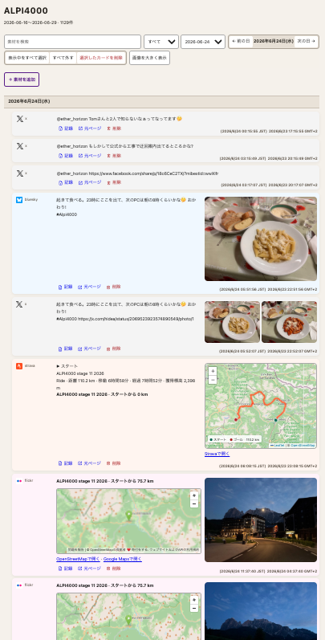

# My Timeline

## 概要

「My Timeline」は、指定した期間やキーワードに合ったSNS投稿や写真、メールなどを収集し、時系列で整理した閲覧環境を構築するためのツールです。収集した素材はFinderで扱える形式で保存され、閲覧用のファイルも生成されます。

### 生成されるタイムラインの例

X、Bluesky、Flickr、Stravaなどの素材を、日付ごとにまとめて時系列で閲覧できます。

[](docs/alpi4000-timeline-example.png)

サポートしている取得元は以下の通りです。

- Bluesky（bskylogのMCP経由）
- X（TwilogのMCP経由）
- Flickr（公開・非公開写真）
- Strava（アクティビティ）
- Gmail（メール）
- EMLファイル（メールのエクスポート）
- 手動追加

## 画面から使う

初回だけ、このフォルダで `npm install` を実行します。以後はFinderで `My Timeline.command` をダブルクリックします。ブラウザで期間と取得元を選び、**収集して開く**を押すと、時系列画面と素材フォルダが自動的に開きます。ターミナルから起動する場合は `npm start` です。

My Timelineはローカルの固定アドレス `http://127.0.0.1:4177/` で動作します。`127.0.0.1` はローカルホストなので外部には公開されません。素材追加リンクとGmail OAuthのリダイレクトURIも、この標準アドレスを前提としています。

行事の記録を書く間だけ使う素材収集ツールです。指定期間（最大31日）のBluesky、X、Flickr、Stravaを集め、Finderで扱えるフラットな素材と、ローカルで開けるタイムラインを「ダウンロード」に生成します。永続DBは使いません。使い終わった後は生成フォルダをFinderから削除できます。

## 準備

### 共通

- macOS
- Node.js 22以上とnpm
- 初回にプロジェクトフォルダで `npm install`
- 出力先は通常 `~/Downloads/My Timeline ...`。ブラウザ画面は `http://127.0.0.1:4177/` を使用

取得元はすべて設定する必要はありません。使うものだけ準備して、収集画面でチェックを入れます。Flickr・Strava・Gmailは起動後の設定画面から資格情報を保存できます。ファイルで設定する場合は、プロジェクト直下に `.env` を作り、`.env.example` を参考に値を記入します。`export` は付けません。

```dotenv
FLICKR_API_KEY="実際の値"
FLICKR_API_SECRET="実際の値"
FLICKR_USER_ID="24796462@N08"
```

`.env` は秘密情報を含むため共有・コミットしないでください。

### Bluesky（bskylog）

1. [bskylog](https://github.com/hidea/app_bskylog)をインストールし、自分のBluesky投稿を同期します。
2. bskylogのMCPサーバーを起動します。
3. `http://localhost:8080/sse` で待受中の状態にしてからMy TimelineでBlueskyを選びます。

別アドレスで起動する場合は `.env` の `BSKYLOG_MCP_URL` を変更します。

### X（Twilog）

- TwilogのMCPを利用できるアカウントが必要です。
- My Timelineは既定で `https://twilog-mcp.togetter.dev/mcp` へ接続します。
- 初回または認証期限切れ時はブラウザが開くので、Twilog側で認証します。ターミナルへ認証コードを入力する必要はありません。
- 通常は `.env` 設定不要です。Bearerトークンを直接使う場合だけ `TWILOG_MCP_TOKEN` を設定します。
- 認証画面に「Unknown OAuth client」と出る場合は、Twilog側で以前の登録が無効になっています。My Timeline下部の「Twilog設定」で「Twilogの認証をやり直す」を押してから収集し直すと、認証からやり直せます。古い認証情報は `~/.mcp-auth/backup-twilog-日時/` に移されます。

### Flickr

1. [Flickr App Garden](https://www.flickr.com/services/apps/create/)でアプリを作成し、KeyとSecretを確認します。
2. My Timeline下部の「Flickr設定」にAPI KeyとユーザーID（例: `24796462@N08`）を入力して保存します。公開写真だけならここまでで使えます。
3. 非公開・限定公開写真も含める場合は、Secretも入力して保存し、「Flickrに接続」を押してブラウザで読み取りを許可します。

ターミナルから設定する場合は、`.env` に `FLICKR_API_KEY`・`FLICKR_API_SECRET`・`FLICKR_USER_ID` を書き、次を実行します。

```sh
node --env-file=.env src/cli.js flickr-auth
```

接続に成功すると `FLICKR_OAUTH_TOKEN`、`FLICKR_OAUTH_TOKEN_SECRET`、ユーザーIDが `.env` に自動追記されます。既存のFlickr Downloadrの暗号化資格情報は読みません。Flickrは通信制限が厳しいため、原寸画像の保存には長時間かかる場合があります。未保存画像は、既存タイムラインの「素材を追加」からFlickrを再実行すると補完されます。

### Strava

1. [Strava API設定](https://www.strava.com/settings/api)でアプリを作成します。
2. Authorization Callback Domainに `127.0.0.1` を指定します。
3. My Timelineを起動し、下部の「Strava設定」にClient IDとClient Secretを入力して保存します。
4. 「Stravaに接続」を押し、ブラウザで読み取りを許可します。

すでにAccess TokenとRefresh Tokenを持っている場合は同じ設定欄へ入力できます。保存された値は `.env` に入ります。

### Gmail

1. [Google Cloud Console](https://console.cloud.google.com/)でプロジェクトを作成します。
2. Gmail APIを有効にします。
3. Google Auth Platformで外部アプリを設定し、自分のGmailアドレスをテストユーザーへ追加します。
4. 読み取り専用スコープ `https://www.googleapis.com/auth/gmail.readonly` を追加します。
5. 「ウェブ アプリケーション」のOAuthクライアントを作成し、承認済みリダイレクトURIへ `http://127.0.0.1:4177/api/gmail/callback` を登録します。
6. My Timeline下部の「Gmail設定」へClient IDとClient Secretを入力して保存し、「Gmailに接続」を押します。

詳細手順はMy Timeline画面内の「Google Cloudでの設定手順」にもあります。Gmailは、キーワード検索欄で指定した日付範囲とキーワードの両方に一致するメールだけを取得します。キーワードと検索期間は必須です。

### EMLファイル

外部設定は不要です。既存タイムラインの「素材を追加」→「EMLファイルからメールを追加」で、別のメールアプリから書き出した `.eml` を最大100件選択できます。Gmail API由来のカードとは分けて `eml` と表示されます。

### 起動確認

1. 必要ならbskylogを先に起動します。
2. `My Timeline.command` をダブルクリックします。
3. ブラウザで `http://127.0.0.1:4177/` が開くことを確認します。
4. Flickr・Strava・Gmailを使う場合は、画面下部の各設定が「接続済み」（Flickrの公開写真だけなら「公開写真のみ」）になっていることを確認します。

起動しない場合は、すでに別のMy Timelineが動いていないか確認してください。標準ポートは4177で、二重起動は想定していません。

## 使い方

```sh
node --env-file-if-exists=.env src/cli.js collect \
  --from 2025-08-01 \
  --to 2025-08-14 \
  --title "京都サイクリングイベント"
```

利用できるソースだけ指定できます。

```sh
node --env-file-if-exists=.env src/cli.js collect \
  --from 2025-08-01 \
  --to 2025-08-14 \
  --sources bluesky \
  --output "$TMPDIR/kyoto-writing"
```

生成物:

- `materials/`: 日時順のMarkdownと画像
- `timeline.html`: 日別表示、検索、取得元の絞り込み（複数選択）、ルートと撮影地点の地図（この日／全期間）付き一覧
- `manifest.json`: 一時ワークスペースの索引

MCPのツール定義は次で確認できます。

```sh
node src/cli.js inspect-mcp --url http://localhost:8080/sse
```

## スキル

Codex向けスキルは `skills/travel-writing/` にあります。完成素材の削除は、ユーザーの明示確認後にだけ行うよう定義しています。

## テスト

```sh
npm test
```
